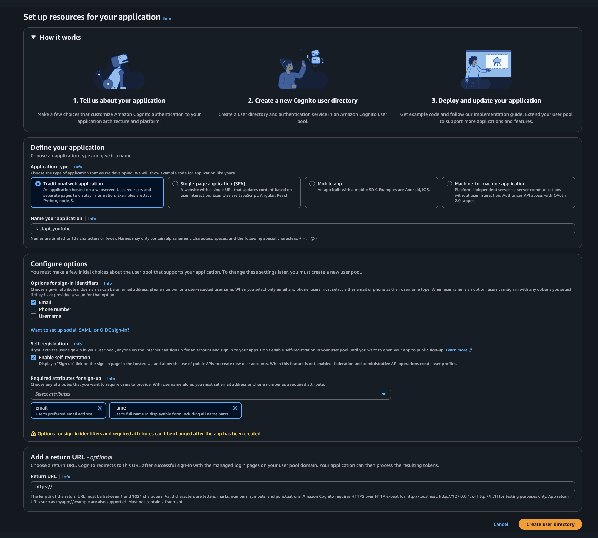
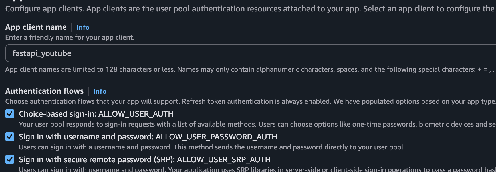

## Start Docker Desktop (macOS)

Needed before any `docker` command. If the daemon is not running you get:

`Cannot connect to the Docker daemon ... Is the docker daemon running?`

```bash
open -a Docker
```

Wait until Docker Desktop is fully up, then continue.

---

## Build the image

Run this from `backend/` (the folder that contains the `Dockerfile`).

```bash
docker build -t fastapi_app .
```

| Part             | Meaning                                                                                                           |
| ---------------- | ----------------------------------------------------------------------------------------------------------------- |
| `docker build`   | Build an image from a Dockerfile                                                                                  |
| `-t fastapi_app` | Tag (name) the image `fastapi_app`                                                                                |
| `.`              | Build context: current directory. Docker reads `Dockerfile` here and copies files from this folder into the image |

---

## Run a container

```bash
docker run -d -p 8000:8000 --name fastapi_container fastapi_app
```

| Part                       | Meaning                                                                                           |
| -------------------------- | ------------------------------------------------------------------------------------------------- |
| `docker run`               | Create and start a container from an image                                                        |
| `-d`                       | Detached: run in the background (no logs attached to this terminal)                               |
| `-p 8000:8000`             | Publish port: `host:container`. Browser `localhost:8000` maps to port `8000` inside the container |
| `--name fastapi_container` | Give the container a stable name (instead of a random one)                                        |
| `fastapi_app`              | Image to run (the tag from `docker build -t`)                                                     |

The app is then available at `http://localhost:8000`.

---

## Useful follow-up commands

```bash
docker ps                          # running containers
docker logs fastapi_container      # container stdout/stderr
docker stop fastapi_container      # stop the container
docker start fastapi_container     # start it again
docker rm fastapi_container        # delete a stopped container
docker images                      # list local images
```

# Use Bind mounts to reload any changes in code to reflect

```yaml
 volumes:
      - ./:/app
    depends_on:
```

# Opne a iteractive sql session

```bash
psql -U postgres -d mydatabase
```

# Create IAM user

Create a user and provide full s3,ec2 and ecs access

# Cognito



## Add sign in with username and password



## Add this policy for s3 bucket to send message to the sqs queue

```json
{
  "Version": "2012-10-17",
  "Id": "__default_policy_ID",
  "Statement": [
    {
      "Sid": "__owner_statement",
      "Effect": "Allow",
      "Principal": {
        "AWS": "arn:aws:iam::649284038865:root"
      },
      "Action": "SQS:*",
      "Resource": "arn:aws:sqs:ap-south-1:649284038865:VideoProcessingQueue"
    },
    {
      "Sid": "AllowS3ToSendMessages",
      "Effect": "Allow",
      "Principal": {
        "Service": "s3.amazonaws.com"
      },
      "Action": "sqs:SendMessage",
      "Resource": "arn:aws:sqs:ap-south-1:649284038865:VideoProcessingQueue",
      "Condition": {
        "ArnEquals": {
          "aws:SourceArn": "arn:aws:s3:::amardeep-raw-videos"
        },
        "StringEquals": {
          "aws:SourceAccount": "649284038865"
        }
      }
    }
  ]
}
```
